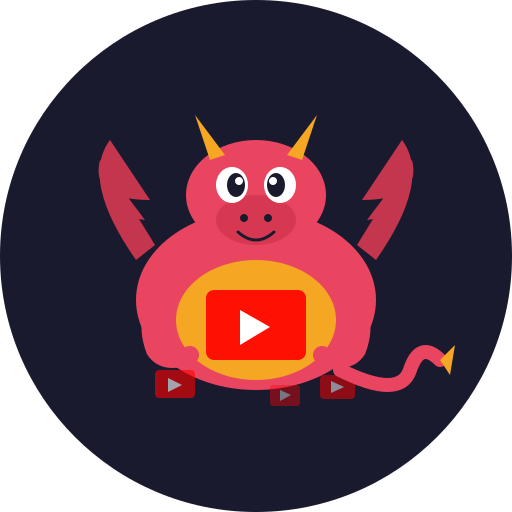

<p align="center">
  
</p>

<h1 align="center">ChannelHoarder</h1>

<p align="center">
  Self-hosted video channel archiver with a modern web UI, designed for Plex-compatible output.<br>
  Runs as a single Docker container and automatically downloads new videos from your subscribed channels.
</p>

---

## Features

- **Multi-platform** - Subscribe to channels (or YouTube playlists) from YouTube, Rumble, Twitch, Dailymotion, Vimeo, and Odysee by URL or @handle
- **Automatic archiving** - Scheduled scans detect new videos and queue them, with per-channel quality (up to 4K), preferred codec (H.264 or VP9), quality cutoff, title (keyword/regex) and duration filters, an exact start date, optional auto-delete of downloaded videos after N days, and per-channel storage paths
- **Plex / Jellyfin / Emby ready** - TV Show-style naming (seasons by year, chronological episodes) with customizable templates, NFO metadata, and poster/season art
- **Sonarr-style episode management** - Monitor/unmonitor, status icons, collapsible seasons, bulk actions, per-episode retry/re-download/rename/delete, and a channel-level Repair Dates action for videos saved with the wrong upload date
- **Robust downloads** - Sequential queue you can order (newest, oldest, shortest, longest), with "download first" channels and a per-item "Move to top", rate limiting and live progress (speed/ETA) over WebSocket, standalone single-video downloads, import of existing files, subtitle and chapter support, and automatic Shorts / livestream filtering
- **Smart authentication** - Cookies (auto-sync via Windows exporter or Tampermonkey, or manual upload) with PO token fallback, optional YouTube Data API key, and a selectable yt-dlp player client
- **Anti-detection** - Configurable download delays, random jitter, and user-agent rotation
- **Monitoring** - Error classification with suggested fixes, diagnostic reports, searchable logs, and Telegram / Pushover / Discord notifications
- **Self-contained** - Single Docker container (web UI, download engine, PO token server, scheduler) with dark-mode UI, current yt-dlp on every image build, and config import/export

## Contents

[Quick Start](#quick-start) · [How It Works](#how-it-works) · [File Organization](#file-organization) · [Configuration](#configuration) · [Cookie Authentication](#cookie-authentication) · [Supported Platforms](#supported-platforms) · [Reference](#reference) · [Troubleshooting](#troubleshooting)

## Quick Start

<details open>
<summary><b>Docker Compose</b></summary>

```yaml
services:
  channelhoarder:
    image: ghcr.io/sworcery/channelhoarder:latest
    container_name: channelhoarder
    ports:
      - "8587:8000"
    volumes:
      - ./config:/config
      - /path/to/your/media/youtube:/downloads
      - ./cookies:/cookies
    environment:
      - PUID=1000
      - PGID=1000
      - TZ=America/New_York
    restart: unless-stopped
```

> **Note:** Set `PUID`/`PGID` to match your media server user so downloaded files have the correct ownership. On Unraid, this is typically `PUID=99` (nobody).

Then open `http://your-server-ip:8587` in your browser. Update later with `docker compose pull && docker compose up -d`.

**Requirements:** Docker & Docker Compose; ~500 MB–1 GB disk per video at best quality (50 GB+ recommended); runs on Linux, macOS, Windows (Docker Desktop), Unraid, or TrueNAS.

</details>

<details>
<summary><b>First steps</b></summary>

1. Go to **Settings → Authentication** and verify the PO Token Server shows **Running**
2. *(Optional)* Add a YouTube Data API key for faster channel discovery
3. *(Optional)* Configure Telegram, Pushover, or Discord notifications
4. Go to **Channels** → **Add Channel** and paste a channel URL
5. Videos will be scanned immediately and queued for download

> **Security note:** ChannelHoarder has no built-in authentication - it is designed for trusted local networks. If exposing to the internet, place it behind a reverse proxy with authentication (e.g. Authelia, Nginx Proxy Manager).

</details>

## How It Works

<details>
<summary><b>Adding channels & automatic scanning</b></summary>

### Adding channels

Paste a channel URL or @handle (e.g. `https://www.youtube.com/@ChannelName`) on the **Channels** page. ChannelHoarder fetches the channel metadata (name, description, thumbnail), adds it to your subscription list, and lets you set per-channel options (quality, custom download directory, enabled/disabled). It can auto-scan immediately after adding. To add many channels at once, use **Bulk Import** to paste a list or upload a CSV/text file, such as YouTube Takeout's `subscriptions.csv`.

### Automatic scanning

- Each channel is scanned at its own random time, every 12 to 24 hours by default (set the interval under Settings > Scanning, and optionally limit scans to certain hours with a scan window on the same tab)
- Optionally, YouTube channels' RSS feeds can be checked every so many minutes (Settings > Scanning, off by default), and a channel is scanned as soon as its feed shows a new video. Checks stay under YouTube's daily feed limit, and interval scans keep running as the backup
- Each scan checks for new videos that haven't been downloaded yet and adds them to the download queue with `pending` status
- If a YouTube Data API key is configured, it's used for faster and more reliable discovery; otherwise yt-dlp handles discovery directly
- Manual scans can be triggered per-channel or for all channels at once

</details>

<details>
<summary><b>Download pipeline</b></summary>

### Downloads

The **Downloads** page shows the queue, the history and the failed downloads. Pause stops new downloads while in-progress ones finish. The pipeline works like this:

1. **Queue Processing** - Every 30 seconds, the next queued video is picked up
2. **Rate Limiting** - A configurable delay (default 10–30 seconds) with optional random jitter is applied between downloads
3. **Download** - yt-dlp downloads the video with PO tokens, plus thumbnail and metadata. By default yt-dlp auto-selects a working player client; a specific client can be forced in Settings → Authentication
4. **Naming** - Files are renamed to the Plex-compatible format with season/episode numbering
5. **Verification** - Output files are verified to exist and the database is updated
6. **Progress** - Real-time progress (speed, ETA, percentage) is broadcast via WebSocket to connected browsers

</details>

<details>
<summary><b>Importing existing videos</b></summary>

### Importing existing videos

If you already have downloaded videos from a channel, you can import them instead of re-downloading:

1. Open a channel's detail page and click **Import Existing**
2. Enter the folder path (on the server) containing your video files
3. ChannelHoarder scans the folder and fuzzy-matches filenames against undownloaded video entries
4. Review the matches with confidence scores, select which to import
5. Imported files are moved into the correct Plex-compatible directory structure

**Important:** Video filenames must contain the original video title for matching to work. Files named with only dates or generic names won't match.

</details>

<details>
<summary><b>Channel & episode management</b></summary>

### Channel management

Open a channel to change how it downloads. The options apply to future scans and leave videos already queued alone:

- **Quality** - the target quality for new downloads, also the cutoff for upgrade searches, and a minimum quality. A video below the minimum isn't downloaded at once: the app waits and checks again after 1, 6 and 24 hours, then the video fails with a "Download anyway" button
- **Codec** - the preferred video codec. H.264 plays on the most devices but on YouTube is usually capped at 1080p; if the codec isn't available the best available format is used, and nothing is re-encoded
- **Publish date** - only download videos published on or after a date
- **Title filter** - include only matching titles, or exclude matching ones
- **Delete after** - remove downloaded files a set number of days after download. The videos stay listed as skipped and are not downloaded again, including after Force Rescan
- **Scan Now** - scans the channel at once. A cooldown (Settings > Scanning) stops repeated clicks

### Episode management

A channel's videos are listed as episodes. Shorts (60 seconds or less, or on the channel's Shorts tab) and livestreams or premieres have their own sections and are skipped unless both Settings > Media Management and the channel allow them. A minimum duration skips shorter videos; the maximum duration in Settings flags longer ones for review. Subtitles, chapters and SponsorBlock are set under Settings > Media Management.

</details>

<details>
<summary><b>Error handling & channel health</b></summary>

When a download fails, ChannelHoarder classifies the error and provides actionable information:

| Error Code | Meaning | Auto-Recovery |
|---|---|---|
| `RATE_LIMITED` | YouTube is throttling requests | Increases delay automatically |
| `GEO_BLOCKED` | Video not available in your region | No |
| `VIDEO_UNAVAILABLE` | Video was deleted or made private | No |
| `FORMAT_UNAVAILABLE` | No downloadable format (player client hit a DRM/SABR restriction) | Retries; set player client to Default (automatic) if persistent |
| `PO_TOKEN_FAILURE` | PO token server is not responding | Retries after health check |
| `YTDLP_OUTDATED` | yt-dlp needs an update | Update the image; each build ships current yt-dlp |
| `FFMPEG_ERROR` | Post-processing failed | Retries up to 3 times |
| `DISK_FULL` | Not enough storage space | No |
| `NETWORK_ERROR` | Connection issue | Retries with backoff |
| `AUTH_EXPIRED` | Authentication needs refresh | Retries with new token |

Each channel also shows a health indicator: **Green** (recent downloads succeeded), **Yellow** (some recent failures), or **Red** (most/all recent downloads failing, with the specific error reason shown).

</details>

## File Organization

<details>
<summary><b>Directory layout & naming template</b></summary>

Videos are saved in Plex TV Show format. Each channel becomes a "show", each year becomes a "season", and videos are numbered as episodes in upload order:

```
/downloads/
  Channel Name/
    tvshow.nfo
    poster.jpg
    Season 2024/
      S2024E001 - Video Title - 20240115 - [videoId].mp4
      S2024E001 - Video Title - 20240115 - [videoId].nfo
      S2024E002 - Another Video - 20240203 - [videoId].mp4
      ...
    Season 2025/
      S2025E001 - New Video - 20250112 - [videoId].mp4
      ...
```

The default naming template is:

```
{channel_name}/Season {season}/S{season}E{episode} - {title} - {upload_date} - [{video_id}]
```

Available template variables: `{channel_name}`, `{season}`, `{episode}`, `{title}`, `{upload_date}`, `{video_id}`

</details>

<details>
<summary><b>Plex library setup</b></summary>

Create a **separate Plex library** for your YouTube channels - do not mix them with your regular TV shows library.

1. In Plex, click **+** to add a new library
2. Select **TV Shows** as the type
3. Point it at your ChannelHoarder downloads folder
4. Under **Advanced**, set the agent to **Personal Media Shows**
5. Check **Use local assets**
6. Save and scan

**Why a separate library?** The Personal Media Shows agent reads episode titles, descriptions, and artwork from the NFO files that ChannelHoarder generates. The default Plex TV agent ignores NFO files and only looks up online databases (TVDB/TMDB), which won't find YouTube channels. Using Personal Media Shows in your regular TV library would break metadata for shows from Sonarr/etc.

If you already added channels to an existing TV library, move them to the new library and unmatch each show for the NFO data to take effect.

</details>

## Configuration

<details>
<summary><b>Environment variables</b></summary>

| Variable | Default | Description |
|---|---|---|
| `PUID` | `1000` | User ID for file permissions |
| `PGID` | `1000` | Group ID for file permissions |
| `TZ` | `America/New_York` | Timezone for scheduling |
| `LOG_LEVEL` | `info` | Logging level (`debug`, `info`, `warning`, `error`) |
| `YOUTUBE_API_KEY` | *(empty)* | Optional YouTube Data API v3 key for reliable channel discovery |
| `POT_SERVER_ENABLED` | `true` | Enable the built-in PO token server |
| `POT_SERVER_URL` | `http://127.0.0.1:4416` | PO token server address (internal to container) |
| `CONFIG_DIR` | `/config` | Configuration and database storage path |
| `DOWNLOAD_DIR` | `/downloads` | Video output directory |
| `EXTRA_DOWNLOAD_DIRS` | *(empty)* | Comma-separated additional allowed download paths (e.g. `/media,/cartoons`) |
| `TEMP_DIR` | *(empty)* | Optional folder for in-progress downloads, such as a volume on an SSD. Finished videos are then moved into their download folder, so a slow or external download drive only gets the finished file. Empty means downloads happen inside the download folder itself |
| `COOKIE_WATCH_DIR` | `/cookies` | Directory watched for cookie file updates |
| `MAX_CONCURRENT_DOWNLOADS` | `1` | Maximum simultaneous downloads |
| `MAX_RETRIES` | `3` | Retry attempts for failed downloads |
| `DOWNLOAD_DELAY_MIN` | `10` | Minimum delay between downloads (seconds) |
| `DOWNLOAD_DELAY_MAX` | `30` | Maximum delay between downloads (seconds) |
| `JITTER_ENABLED` | `true` | Add random 0–10s jitter between downloads |
| `USER_AGENT_ROTATION` | `true` | Rotate browser user-agent strings |

From 2.0, `MAX_RETRIES`, `USER_AGENT_ROTATION` and `LOG_LEVEL` are starting values only. Whatever is saved in Settings wins.

</details>

<details>
<summary><b>YouTube Data API key (optional)</b></summary>

### YouTube Data API key (optional)

A YouTube Data API key improves channel scanning reliability and speed. Without it, yt-dlp handles discovery directly, which works but can be slower.

To get a free API key:

1. Go to [console.cloud.google.com](https://console.cloud.google.com/) and sign in with your Google account
2. Click **Select a project** at the top, then **New Project**. Name it anything (e.g. "ChannelHoarder") and click **Create**
3. Make sure your new project is selected, then go to **APIs & Services > Library**
4. Search for **YouTube Data API v3** and click on it
5. Click **Enable**
6. Go to **APIs & Services > Credentials**
7. Click **+ Create Credentials > API key**
8. Copy the API key that appears
9. In ChannelHoarder, go to **Settings > Authentication** and paste the key, or set the `YOUTUBE_API_KEY` environment variable in your container config

The free tier provides 10,000 quota units per day, which is enough for most personal use. No billing account is required.

</details>

<details>
<summary><b>Settings (via Web UI)</b></summary>

All settings are on the **Settings** page, in seven tabs. Type in the search box at the top to find any setting by name; choosing a result opens its tab and highlights it. Changes on the General, Scanning, Media Management, Anti-Detection and Notifications tabs wait for the **Save** button in the bar that appears at the bottom; **Discard** puts the saved values back. Switching tabs or leaving the page with unsaved changes asks first. On the Authentication and Diagnostics tabs, and for Export/Import Config, Scan All Channels Now, naming Preview and the notification test buttons, the action happens when you press its button.

- **General** - Default quality, max concurrent downloads, max retries, log level, system info, the bundled yt-dlp version, config export/import
- **Scanning** - How often each channel is scanned, RSS feed checks for new YouTube uploads, the scan window (limit scans to certain hours), the Scan Now cooldown, and a Scan All Channels Now button
- **Media Management** - Output filename template with live preview (`{channel_name}`, `{season}`, `{episode}`, `{title}`, `{upload_date}`, `{video_id}`), Shorts and livestream opt-in, subtitles, chapters, SponsorBlock, file permissions, max video duration filter
- **Authentication** - PO token status, cookie upload/status, browser cookie sync (Tampermonkey), YouTube API key, player client strategy
- **Anti-Detection** - Download delay range, random jitter, user-agent rotation, scan jitter
- **Notifications** - Telegram, Pushover, and Discord configuration with test buttons, per-event toggles
- **Diagnostics** - System overview and the diagnostic report, error logs, system logs, the Library Check and Shared Folders repair tools

Environment variables set the starting values; see the table above.

</details>

<details>
<summary><b>Anti-detection & notifications</b></summary>

### Anti-detection

Random delays between downloads (default 10 to 30 seconds), optional random jitter (0 to 10 extra seconds), rotating user-agent strings and a random pause between channel scans keep traffic from looking like a script. All of it is under **Settings > Anti-Detection**.

### Notifications

Under **Settings > Notifications**, add a Telegram bot (token and chat ID), Pushover (application token and user key) and/or a Discord webhook URL. Save first, then use the test buttons, which send through the saved settings. Per-event toggles choose what triggers a message: downloads finishing or failing, cookies expiring or refreshing, health alerts, long videos waiting for review, moves, scans and quality upgrades.

</details>

## Cookie Authentication

<details>
<summary><b>PO tokens & player client</b></summary>

### PO tokens

YouTube asks clients to prove they are a real browser. The built-in PO token server makes those proofs automatically, so downloads work without any setup. **Settings > Authentication** shows whether it is running. When you also upload cookies, the cookies take priority.

### Player client

The player client is the YouTube API yt-dlp uses to list a video's formats. Leave it on **Default (automatic)**: yt-dlp picks a working client and adapts when YouTube changes. Override it only if one specific video fails with a format error; `ios` and `web_safari` are good fallbacks. The choice applies as soon as you select it.

</details>

<details>
<summary><b>Cookie authentication (optional) - three methods</b></summary>

Cookies are optional but can help if you have YouTube Premium, need to access region-specific content, or want to download **premium/authenticated Rumble** content. The same `cookies.txt` covers all platforms - cookies are matched per-domain, so you can include YouTube and Rumble cookies in one file. There are three ways to provide cookies:

**Option 1: Automatic Cookie Sync (Recommended)**

The Windows cookie exporter reads cookies directly from Firefox's database, including HttpOnly cookies that browser scripts cannot access.

1. Install Python 3.10+ and [pycryptodome](https://pypi.org/project/pycryptodome/) on a Windows machine or VM
2. Install Firefox and log into YouTube
3. Copy the `tools/` folder from this repository to the machine
4. Edit `cookie_exporter.ini`:
   - Set `server_url` to your ChannelHoarder address (e.g., `http://your-server:8587`)
   - Optionally set `profile` if using a non-default Firefox profile
   - Optionally set `domains` to customize which cookie domains to export (default: `.youtube.com, .google.com, .rumble.com` - log into Rumble in Firefox too if you want premium Rumble content)
   - Optionally set `refresh_url` to change the page loaded before export (default: `https://www.youtube.com`)
   - Optionally set `refresh_wait` to change seconds to wait for page load (default: `20`)
5. Run `python cookie_exporter.py --dry-run` to test
6. Run `install_task.bat` as administrator to set up automatic export every 30 minutes
7. Every run: opens Firefox to YouTube (refreshes cookies) → closes Firefox → reads the cookie DB → pushes to ChannelHoarder via API

**Option 2: Browser Cookie Sync (Tampermonkey)**

1. Install the [Tampermonkey](https://www.tampermonkey.net/) browser extension
2. Go to **Settings > Authentication** in ChannelHoarder and click **Install Tampermonkey Script**
3. The script comes pre-configured with your server address and exports cookies each time you load a YouTube page (with a 5-minute cooldown between exports)
4. Note: Cannot access HttpOnly cookies (SID, HSID, SSID) - Option 1 is more complete

**Option 3: Manual Upload**

1. Use a cookie export extension (e.g., "Get cookies.txt LOCALLY")
2. Navigate to youtube.com while logged in and export cookies
3. Upload the file via **Settings > Authentication** in the web UI

Cookies expire periodically. Options 1 and 2 handle re-export automatically.

</details>

## Supported Platforms

| Platform | Channel Discovery | Video Download | API Support |
|---|---|---|---|
| YouTube | RSS + API + yt-dlp | yt-dlp | YouTube Data API v3 |
| Rumble | yt-dlp | yt-dlp | No |
| Twitch | yt-dlp | yt-dlp | No |
| Dailymotion | yt-dlp | yt-dlp | No |
| Vimeo | yt-dlp | yt-dlp | No |
| Odysee | yt-dlp | yt-dlp | No |

## Reference

<details>
<summary><b>Tech stack & volumes</b></summary>

### Tech stack

- **Backend**: Python 3.12, FastAPI, SQLAlchemy (async), APScheduler, yt-dlp
- **Frontend**: React 18, TypeScript, Tailwind CSS, TanStack Query, React Router
- **Database**: SQLite (WAL mode)
- **Auth**: bgutil-ytdlp-pot-provider (PO tokens), optional cookies.txt
- **Docker**: Multi-stage build with Python, Node.js, ffmpeg, Deno, and the PO token provider

**Volumes:**

| Path | Purpose |
|---|---|
| `/config` | Database, settings, API key, optional cookies.txt |
| `/downloads` | Downloaded videos, thumbnails, and metadata (point Plex here) |
| `/cookies` | Optional: watched directory for cookie file updates |

</details>

<details>
<summary><b>API</b></summary>

ChannelHoarder exposes a REST API under `/api/v1/` plus a WebSocket for live progress. See [docs/API.md](docs/API.md) for the full endpoint list, or browse the interactive Swagger UI at `/docs` on a running instance.

**Dashboard widgets:** `GET /api/v1/dashboard/stats` returns channel, download, queue and storage counts as JSON, so dashboard apps can show them. For [Homepage](https://gethomepage.dev/), use its Custom API widget:

```yaml
- ChannelHoarder:
    href: http://your-server:8587
    widget:
      type: customapi
      url: http://your-server:8587/api/v1/dashboard/stats
      mappings:
        - field: total_channels
          label: Channels
        - field: total_downloaded
          label: Downloaded
        - field: queue_length
          label: Queue
        - field: storage_used_bytes
          label: Storage
          format: bytes
```

</details>

<details>
<summary><b>Known limitations</b></summary>

- **YouTube Shorts** - YouTube videos of 60 seconds or less (or on the Shorts tab) are treated as Shorts and skipped by default (toggleable per channel)
- **Livestreams / long videos** - Videos over the max duration setting are skipped by default
- **Geo-blocked content** - Cannot download region-restricted videos
- **Private / deleted videos** - Automatically skipped if no longer available
- **No built-in auth** - Designed for trusted local networks; use a reverse proxy if internet-facing
- **Rate limiting** - YouTube may throttle requests; the PO token server and configurable delays help mitigate this

</details>

## Troubleshooting

<details>
<summary><b>Library repair (Settings > Diagnostics)</b></summary>

### Library repair

Two tools fix problems older versions could leave behind. Both show what they found before changing anything, and neither overwrites a file.

**Library Check.** Before 1.9.50, a scan could move a downloaded file onto a newer video with a similar title (for example "Week 11" and "Week 12") and rename it. Run the check once if you have channels with numbered titles. It lists:
- files that are certainly filed under the wrong video, from the file's embedded source address or the `.info.json` beside it. "Fix all certain" moves each to the video it really belongs to and queues the wrongly filed video to download again;
- likely mismatches, found from the file's length. Fix these one at a time;
- downloaded videos whose file is gone. Re-download or skip them;
- files to check by hand.

**Shared Folders.** Before 1.9.50, two channels with the same name (for example one creator on YouTube and on Rumble) shared one folder. New channels get their own folder, such as "Creator (Rumble)". For existing ones, the dashboard shows a notice, and this tool moves the channel you pick into a folder of its own. Files the other channel uses, shared artwork and files neither channel knows about stay where they are.

</details>

<details>
<summary><b>Common issues & fixes</b></summary>

**Queue not downloading / stuck**
- Check Settings → Authentication: PO Token Server must show **Running**
- Check Settings → Diagnostics → System Logs for error details
- If cookies expired, upload fresh ones via Settings → Authentication

**"Sign in to confirm you're not a bot"**
- Your session has been flagged - try uploading fresh cookies
- Adding a YouTube Data API key improves reliability
- Wait 1–2 hours if recently rate-limited

**Downloads failing with "Requested format is not available"**
- YouTube restricts certain player clients (DRM-protected or URL-less SABR formats), leaving nothing downloadable
- Set the player client to **Default (automatic)** in Settings → Authentication so yt-dlp picks a working client and adapts to YouTube's changes
- If a specific video still fails, try `ios` or `web_safari` from the same dropdown
- Make sure the image is up to date (each build ships current yt-dlp)

**Plex not showing downloaded videos**
- Ensure your `/downloads` path is added as a **TV Shows** library in Plex
- Trigger a library scan: Plex → Libraries → Scan Library Files
- Check that `PUID`/`PGID` match your Plex user so files are readable

**Port conflict on 8587**
- Change the host-side port: `"8590:8000"` - then access via `:8590`

**Container writes files as root**
- Ensure `PUID` and `PGID` are set correctly in your compose/template
- The internal port is always `8000`; the host port is configurable

</details>

## Support

For bugs or feature requests, open a GitHub issue and include the diagnostic report from **Settings → Diagnostics → System Overview → Copy Diagnostic Report**.

## License

MIT License - free to use, modify, and distribute with attribution. See [LICENSE](LICENSE) for details.
